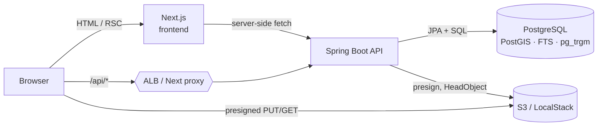
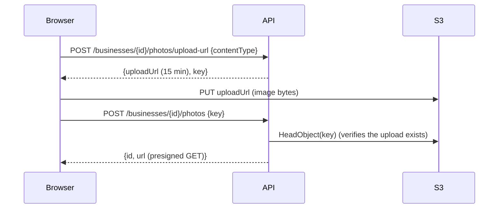
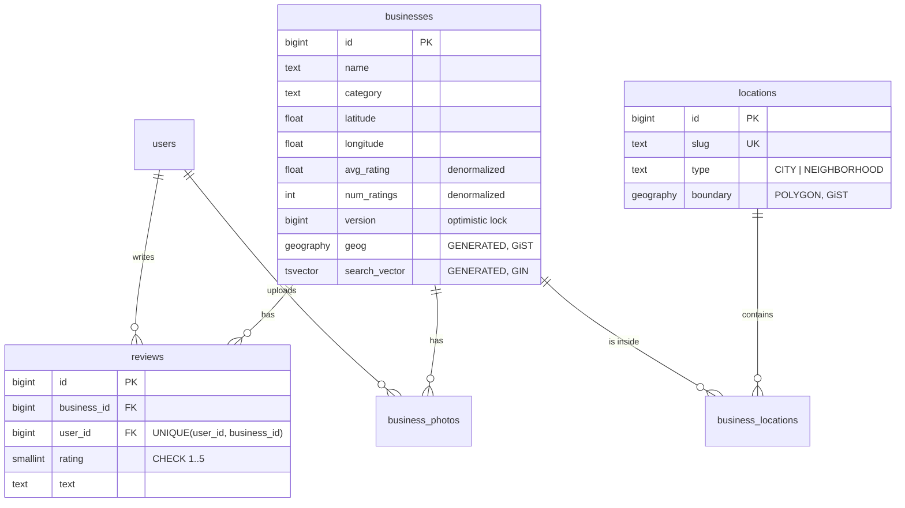

# Local Eats: a Yelp-style app

A full-stack business search and review app built from the
[Hello Interview Yelp system design breakdown](https://www.hellointerview.com/learn/system-design/problem-breakdowns/yelp).

| Layer    | Tech |
|----------|------|
| Frontend | Next.js 16 (App Router, React 19, Tailwind 4), server-rendered business pages |
| Backend  | Spring Boot 3.5 (Java 21), Spring Security (JWT), JPA + JDBC, Flyway |
| Database | PostgreSQL 16 + **PostGIS** (geo search) + full-text search + `pg_trgm` |
| Storage  | S3 for photos (LocalStack locally), presigned direct uploads |
| Deploy   | Docker Compose locally. Terraform to AWS (ECS Fargate, RDS, ALB, S3, ECR, Secrets Manager) |

---

## Contents

1. [Quick start](#1-quick-start)
2. [Features and how to use them](#2-features-and-how-to-use-them)
3. [Architecture](#3-architecture)
4. [How the design maps to the Hello Interview guide](#4-how-the-design-maps-to-the-hello-interview-guide)
5. [API reference](#5-api-reference)
6. [Data model](#6-data-model)
7. [Configuration](#7-configuration)
8. [Local development without Docker](#8-local-development-without-docker)
9. [Testing](#9-testing)
10. [Deploying to AWS](#10-deploying-to-aws)
11. [Project structure](#11-project-structure)
12. [Troubleshooting](#12-troubleshooting)

---

## 1. Quick start

**Prerequisites:** Docker Desktop (or another Docker engine). Nothing else is needed to run the app.

```bash
cp .env.example .env          # optional: change ports or add a LocalStack token
docker compose up -d --build  # postgres + localstack + backend + frontend
scripts/smoke-test.sh         # optional: 15 end-to-end checks
```

| What | URL |
|------|-----|
| Web app | http://localhost:3000 |
| REST API | http://localhost:8080/api |
| Health | http://localhost:8080/actuator/health |
| Postgres | `localhost:5434`, db/user/password `yelp` |
| LocalStack (S3) | http://localhost:4568 |

The database is migrated and seeded on first boot. The seed has 26 real-world businesses in San Francisco
and New York, and 7 named areas (2 cities, 5 neighborhoods).

> **Port clashes:** host ports default to 5434 / 4568 / 8080 / 3000 so the stack can run beside other
> local stacks. Override them in `.env` with `POSTGRES_HOST_PORT`, `LOCALSTACK_HOST_PORT`, `BACKEND_HOST_PORT`, `FRONTEND_HOST_PORT`.
>
> **LocalStack token:** `localstack/localstack:4.14` runs without an account. If you move to a 2026.x
> image, put your free `LOCALSTACK_AUTH_TOKEN` in `.env`.

Stop the stack with `docker compose down`. Add `-v` to also wipe the database volume.

---

## 2. Features and how to use them

### 2.1 Search businesses (name, category, location)
Open http://localhost:3000. Every filter can be combined with the others.

| Filter | How | Example |
|--------|-----|---------|
| **Text** | Type words or part of a name. Word matches use Postgres full-text search, weighted name > category > description. Partial names use trigram matching. | `burrito`, `pizza napoletana`, `taq` |
| **Named area** | Pick a city or neighborhood in the "Where" dropdown | *Mission District*, *New York* |
| **Near me** | Pick 📍 *Near me* and a radius (1–50 km). The browser asks for your location. | Within 5 km |
| **Category** | Category dropdown (filled from the data) | *Coffee* |
| **Sort** | Best match (text rank, or distance when searching near you), highest rated, closest | |

Results show the average rating, review count, category, and distance (near-me searches only). Results are
paginated. Search state lives in the URL (`/?query=pizza&location=new-york`), so you can share a search
and the back button works.

API equivalent:
```bash
curl 'localhost:8080/api/businesses?query=coffee&location=sf-mission'
curl 'localhost:8080/api/businesses?lat=37.7614&lng=-122.4241&radius=1000&sort=DISTANCE'
curl 'localhost:8080/api/businesses?category=Pizza&sort=RATING&page=0&size=10'
```

### 2.2 View a business and its reviews
Click a result. The business page (`/businesses/{id}`) is **server-rendered**, so it's fast and
indexable. It shows the details, a link to the map, photos, the average rating, and the 10 newest reviews.
**Show more reviews** loads further pages.

### 2.3 Sign up / log in
Use **Sign up** (email, display name, password with 8+ characters) or **Log in** in the header. The API returns a
JWT (HS256, 24h by default). The browser keeps it and sends it as `Authorization: Bearer …`.

### 2.4 Leave a review (1–5 stars + optional text)
While logged in, open a business, pick a star rating, add optional text, and choose **Post review**. The
business's average and count update right away.
- **One review per user per business.** A second attempt returns `409 Conflict` and the form says
  so. The database enforces this, so it holds even for two requests sent at the same moment.

### 2.5 Upload photos
While logged in, choose **Add photo** on a business page (JPEG, PNG, WebP, or GIF). The file goes **straight
from the browser to S3** (LocalStack locally) through a presigned URL. The API never handles the image bytes.

### 2.6 Add a business
While logged in, choose **Add a business** in the header. Enter the name, category, address, and coordinates (or
use 📍 *Use my current location*). The new business is **automatically tagged** with every city and
neighborhood whose boundary contains it, so it appears in searches like "Mission District" right away.

---

## 3. Architecture



**Request routing.** Browser code always calls same-origin `/api/*`:
- **Locally / Docker:** a Next.js catch-all route handler (`frontend/src/app/api/[...path]/route.ts`)
  forwards the request to `BACKEND_URL`. It reads that variable at request time, so one image works everywhere.
- **AWS:** the ALB routes `/api/*` straight to the Spring Boot service and everything else to Next.js.

Because every call is same-origin, the browser needs no CORS setup. The backend still has a CORS
allow-list for direct API callers.

**Photo upload flow**


---

## 4. How the design maps to the Hello Interview guide

### Functional requirements
| Requirement | Implementation |
|---|---|
| Search by name, location (lat/long), category | `GET /api/businesses` with full-text + trigram, `ST_DWithin`, a category filter, and named areas |
| View business + reviews | `GET /api/businesses/{id}` (details + first page of reviews + photos) and `GET …/reviews?page=` |
| Leave a review (1–5 stars, optional text) | `POST /api/businesses/{id}/reviews`, validated with `@Min(1) @Max(5)` plus a DB `CHECK` |

### Non-functional requirements
| Requirement | How it's addressed |
|---|---|
| **Low-latency search (< 500 ms)** | Every search predicate has an index: GiST on a generated `geography` column, GIN on a generated `tsvector`, GIN trigram on `name`, and a precomputed area table. Ratings are denormalized, so search never aggregates reviews. Pagination fetches `size+1` rows and skips `COUNT(*)`. |
| **Highly available, eventual consistency OK** | Stateless API and web tiers behind an ALB, at least 2 tasks each across 2 AZs, CPU autoscaling, optional Multi-AZ RDS (`db_multi_az`), and ECS deployment circuit breaker with rollback. |
| **Scale (100M DAU, 10M businesses)** | 10M rows with these indexes fit comfortably in one Postgres primary. Reads are ~100:1 to writes, so the next steps are RDS read replicas for `/businesses` GETs and a CDN or cache for business pages. The guide's larger-scale option is moving search to Elasticsearch or OpenSearch fed by CDC. |

### Deep dives

**1. Average rating without recalculating on every read.**
`businesses.avg_rating` and `num_ratings` are stored on the row and updated **in the same transaction**
that inserts the review (`ReviewService.create` → `Business.applyRating`). Concurrent reviews on
the same business are handled with **optimistic locking** (`@Version`). If two writers race, the loser's
whole transaction, including its review insert, rolls back and retries with jittered backoff.
`ApiIntegrationTest.concurrentReviewsAreAllCountedDespiteOptimisticLocking` fires 8 simultaneous
reviews and checks that none are lost.

**2. One review per user per business.**
`CONSTRAINT uq_reviews_user_business UNIQUE (user_id, business_id)`. The service also checks up front
so it can return a friendly error, but **the constraint is the real guarantee**: under a race, the
second insert fails, and the resulting `DataIntegrityViolationException` becomes `409`.

**3. Efficient geo + text search.**
PostGIS `geography(Point)` plus a GiST index gives true meter-based radius queries (`ST_DWithin`) and distance
sorting. This is the same job the guide's quadtree or geohash options do, handled by the database.
Full-text uses a weighted generated `tsvector` with `websearch_to_tsquery` (so quotes, `OR`, and `-word` work).

**4. Search by named areas ("Mission District", "New York").**
Areas are stored as **polygons** in `locations`. Instead of running a point-in-polygon check on every search,
membership is **precomputed at write time** into `business_locations`, both in the seed and in
`BusinessRepository.assignLocations` when a business is created. A search by area is then a primary-key join.

---

## 5. API reference

Base path `/api`. Errors use RFC 7807 `application/problem+json` (`{status, title, detail}`).
🔒 means the request needs `Authorization: Bearer <jwt>`.

| Method | Path | Body / query | Response |
|---|---|---|---|
| POST | `/auth/register` | `{email, displayName, password}` | `201 {token, user}`. `409` if the email is taken |
| POST | `/auth/login` | `{email, password}` | `200 {token, user}`. `401` if the credentials are wrong |
| GET 🔒 | `/auth/me` | – | `{id, email, displayName}` |
| GET | `/businesses` | `query, category, lat, lng, radius (m, 100–50000, default 5000), location (slug), sort (RELEVANCE\|RATING\|DISTANCE), page (0-based), size (≤50)` | `{items: BusinessSummary[], page, size, hasMore}` |
| GET | `/businesses/{id}` | – | `BusinessDetail` (includes `recentReviews`, `hasMoreReviews`, `photos`) |
| POST 🔒 | `/businesses` | `{name, category, address, latitude, longitude, description?, phone?, website?}` | `201 BusinessDetail` |
| GET | `/businesses/{id}/reviews` | `page, size` | `{items: Review[], page, size, hasMore}` |
| POST 🔒 | `/businesses/{id}/reviews` | `{rating: 1-5, text?}` | `201 Review`. `409` if you already reviewed this business |
| GET | `/businesses/{id}/photos` | – | `Photo[]` with short-lived presigned URLs |
| POST 🔒 | `/businesses/{id}/photos/upload-url` | `{contentType: image/jpeg\|png\|webp\|gif}` | `{uploadUrl, key, contentType, expiresInSeconds}` |
| POST 🔒 | `/businesses/{id}/photos` | `{key, caption?}` | `201 Photo`. `400` if nothing was uploaded under `key` |
| GET | `/locations` | – | `[{id, name, slug, type: CITY\|NEIGHBORHOOD}]` |
| GET | `/categories` | – | `string[]` |

Full example session:
```bash
API=localhost:8080/api
TOKEN=$(curl -s -X POST $API/auth/register -H 'Content-Type: application/json' \
  -d '{"email":"me@example.com","displayName":"Me","password":"password123"}' | jq -r .token)

curl -s -X POST $API/businesses/1/reviews -H "Authorization: Bearer $TOKEN" \
  -H 'Content-Type: application/json' -d '{"rating":5,"text":"Best burrito in town"}'

curl -s $API/businesses/1 | jq '{name, avgRating, numRatings}'
```

---

## 6. Data model



Flyway migrations are in `backend/src/main/resources/db/migration`: `V1__schema.sql` holds the schema and indexes,
and `V2__seed.sql` holds the sample data. To add a named area, insert a polygon into `locations` and backfill it:
```sql
INSERT INTO business_locations SELECT b.id, l.id FROM businesses b JOIN locations l
  ON ST_Covers(l.boundary, b.geog) WHERE l.slug = 'your-new-slug' ON CONFLICT DO NOTHING;
```

---

## 7. Configuration

### Backend (environment variables)
| Variable | Default | Notes |
|---|---|---|
| `DB_URL` | `jdbc:postgresql://localhost:5434/yelp` | |
| `DB_USERNAME` / `DB_PASSWORD` | `yelp` / `yelp` | Injected from Secrets Manager on AWS |
| `JWT_SECRET` | dev value | **At least 32 bytes.** Generated by Terraform on AWS |
| `JWT_TTL_HOURS` | `24` | |
| `CORS_ALLOWED_ORIGINS` | `http://localhost:3000` | Comma-separated |
| `S3_BUCKET` | `yelp-photos` | |
| `AWS_REGION` | `us-east-1` | |
| `S3_ENDPOINT` | *(empty)* | Set it **only** for LocalStack. Turns on path-style access and dummy credentials |
| `S3_PUBLIC_ENDPOINT` | = `S3_ENDPOINT` | Host used in presigned URLs. It must be reachable **from the browser** |

Search tuning lives in `application.yml` under `app.search` (default radius, max radius, max page size).

### Frontend
| Variable | Default | Notes |
|---|---|---|
| `BACKEND_URL` | `http://localhost:8080` | Used by server components and the `/api` proxy. Read at runtime |

---

## 8. Local development without Docker

Run only the infrastructure in Docker, and the apps with hot reload:

```bash
docker compose up -d postgres localstack

# Backend (JDK 21+). The `local` profile points S3 at LocalStack on :4568.
cd backend && ./mvnw spring-boot:run -Dspring-boot.run.profiles=local

# Frontend (Node 20.9+), in a second terminal
cd frontend && npm install && npm run dev      # http://localhost:3000
```

---

## 9. Testing

```bash
cd backend && ./mvnw test        # needs Docker running (Testcontainers starts PostGIS)
cd frontend && npm run lint && npm run build
scripts/smoke-test.sh            # against the running stack (default http://localhost:3000)
scripts/smoke-test.sh https://your-app.example.com   # also works against AWS
```

| Suite | Covers |
|---|---|
| `BusinessRatingTest` | Incremental average math |
| `ApiIntegrationTest` (real PostGIS) | Text, partial-name, radius and distance sort, named-area, and category+area search. Pagination. Review → aggregate update. Duplicate review → 409. **8 concurrent reviews all counted.** Auth required. Validation |
| `scripts/smoke-test.sh` | All of the above, end to end through Next.js, plus register/login, creating a business with automatic area tagging, and a real presigned **S3 upload and download via LocalStack** |

CI (`.github/workflows/ci.yml`) runs the backend tests, frontend lint and build, and `terraform validate`.

---

## 10. Deploying to AWS

### What gets created (`infra/terraform`)
```
VPC (2 AZs): public subnets ─ ALB (:80, optional :443)
                             ├─ /api/*  → ECS service "backend"  (Fargate ARM64, 2+ tasks, CPU autoscaling)
                             └─ /*      → ECS service "frontend" (Fargate ARM64, 2 tasks)
             private subnets ─ ECS tasks (outbound via NAT)
             database subnets ─ RDS PostgreSQL 16 (encrypted, 7-day backups, optional Multi-AZ)
S3 bucket (private, encrypted, CORS for the app origin) · ECR repos · CloudWatch Logs
Secrets Manager: RDS-managed master password + generated JWT secret
IAM: execution role (ECR/logs/secrets) · backend task role (S3 Get/Put on the photo bucket only)
```
PostGIS needs no extra setup. RDS includes the extension, and Flyway runs `CREATE EXTENSION postgis`
when the backend starts for the first time.

### Prerequisites
- AWS account + **AWS CLI v2** logged in (`aws sts get-caller-identity` works)
- Terraform ≥ 1.6, Docker with `buildx`

### Deploy (one command)
```bash
cp infra/terraform/terraform.tfvars.example infra/terraform/terraform.tfvars   # edit if needed
scripts/deploy-aws.sh
```
The script:
1. creates the ECR repositories (`terraform apply -target`),
2. builds **linux/arm64** images for the backend and frontend and pushes them, tagged with the git SHA or a timestamp,
3. applies the rest of the infrastructure with `image_tag` set to that tag,
4. waits for both ECS services to become stable, then prints the app URL.

The first run takes about 15 minutes, mostly waiting on RDS. Later runs just redeploy: run the script again. ECS
does a rolling update and rolls back automatically if the new tasks fail health checks.

### HTTPS + custom domain
1. Request an ACM certificate for your domain in the same region.
2. In `terraform.tfvars`, set `certificate_arn = "arn:aws:acm:…"` and `app_domain = "eats.example.com"`.
3. Re-run `scripts/deploy-aws.sh`, then point a DNS CNAME or Route 53 alias at the `alb_dns_name` output.
   HTTP will then redirect to HTTPS, and CORS and the S3 CORS rule use your domain.

### Production hardening knobs
| Variable | Default | Production suggestion |
|---|---|---|
| `db_multi_az` | `false` | `true` |
| `db_instance_class` | `db.t4g.micro` | `db.r7g.large` or larger |
| `single_nat_gateway` | `true` | `false` (one NAT per AZ) |
| `backend_desired_count` | `2` | Size to traffic. Autoscaling goes up to 5× |
| RDS `deletion_protection` (in `data.tf`) | `false` | `true` |
| Terraform state | local | Uncomment the S3 `backend` block in `versions.tf` |

### Operating it
```bash
aws logs tail /ecs/yelp/backend --follow        # backend logs
aws logs tail /ecs/yelp/frontend --follow
terraform -chdir=infra/terraform output         # URLs, bucket, DB endpoint
```

### Tear down
```bash
terraform -chdir=infra/terraform destroy
```
RDS takes a final snapshot. Empty the photo bucket first, because `force_destroy` is off to protect your data.

### Rough cost (us-east-1, defaults)
About $90–110 a month: the ALB (~$18), one NAT gateway (~$33 + data), 4 small Fargate ARM tasks (~$30), and db.t4g.micro RDS (~$13).

---

## 11. Project structure

```
.
├── docker-compose.yml            # postgres(PostGIS) + localstack + backend + frontend
├── localstack/init/              # creates the S3 bucket + CORS on LocalStack startup
├── backend/                      # Spring Boot
│   └── src/main/java/com/yelpclone/
│       ├── auth/                 # register/login/me, JWT issuing, User entity
│       ├── business/             # entity, JPA repo, SQL search repository, service, controller
│       ├── review/               # reviews + rating aggregate w/ optimistic-lock retry
│       ├── photo/                # presigned S3 upload/download
│       ├── location/             # named areas
│       ├── config/               # security (JWT resource server), S3 clients, typed properties
│       └── common/               # pagination, errors
├── frontend/                     # Next.js
│   └── src/
│       ├── app/                  # pages: / (search), /businesses/[id], /businesses/new, /login, /register
│       │   └── api/[...path]/    # runtime proxy to the backend
│       ├── components/           # SearchPage, ReviewSection, PhotoSection, Stars, AuthProvider…
│       └── lib/                  # API clients (browser + server), types
├── infra/terraform/              # AWS: VPC, RDS, S3, ECR, ECS Fargate, ALB, IAM, autoscaling
├── scripts/
│   ├── smoke-test.sh             # end-to-end feature check
│   └── deploy-aws.sh             # build → push → terraform apply → wait
└── .github/workflows/ci.yml
```

---

## 12. Troubleshooting

| Symptom | Fix |
|---|---|
| `Bind for 0.0.0.0:5432 failed: port is already allocated` | Another stack is using the port. Set `POSTGRES_HOST_PORT` (and the other `*_HOST_PORT` variables) in `.env` |
| `no matching manifest for linux/arm64` for PostGIS | Use `imresamu/postgis` (already the default). The official `postgis/postgis` image has no arm64 build |
| LocalStack exits asking for a license or auth token | Put `LOCALSTACK_AUTH_TOKEN` in `.env`, or keep the pinned `4.14` tag |
| Photo upload fails with a CORS error | The origin must be in the bucket's CORS rule: `localstack/init/01-create-bucket.sh` locally, or `app_domain` on AWS |
| Photo upload works but the image doesn't load locally | `S3_PUBLIC_ENDPOINT` must match the LocalStack **host** port (`LOCALSTACK_HOST_PORT`) |
| Backend tests fail to start | Docker must be running. Testcontainers pulls `imresamu/postgis:16-3.5` |
| `401` on write endpoints | Log in again. JWTs expire after `JWT_TTL_HOURS` |
| ECS tasks keep restarting on AWS | Run `aws logs tail /ecs/yelp/backend`. The usual cause is the first Flyway migration (check the RDS security group or subnets) |
